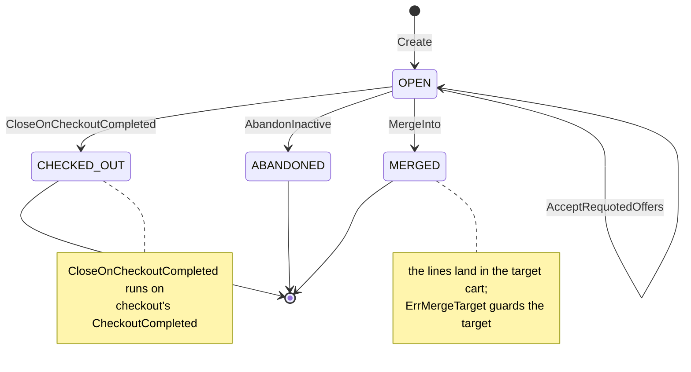

# Aggregate design canvas

Following the ddd-crew [Aggregate Design Canvas v1.1](https://github.com/ddd-crew/aggregate-design-canvas).
This context has one aggregate root, **Cart**, and three read models,
**CheckoutReadiness**, **PurchasabilityView** and **EstimateView**. Go packages:
`internal/domain/cart`, `internal/domain/estimate` and `internal/domain/shared`.

## Cart

### 1. Name

`Cart` (`cart.Cart`), identified by `cartId` (`cart.ID`).

### 2. Description

One shopper's cart: optional `shopperId` (guest-first), lines (`catalogItemId`,
`quantity`), `destinationPostalPrefix`, the delivery quote (groups with their line
numbers and offers, plus the tiers that were unavailable), the selections
(`groupNo` to `offerId`), `createdAt`, `lastChangedAt` and `version`. Value objects:

| Value object | Fields | Note |
| --- | --- | --- |
| `cart.Line` | `CatalogItemID`, `Quantity` | One line per item; quantity 1 to 99. |
| `cart.QuotedOffer` | `OfferID`, `GroupNo`, `Tier`, `DeliverByEarliest`, `DeliverByLatest` (calendar dates), `ExpiresAt` | One offer held by the quote; a frozen delivery-promise fact. |
| `cart.QuoteGroup` | `GroupNo`, `LineNos` (1-based, cart order), `Offers` | One shipment group. |
| `cart.TierUnavailable` | `Tier`, `Constraint`, `GroupNo` (0 = the whole quote) | Why a tier has no offer. |
| `cart.Selection` | `GroupNo`, `OfferID` | The shopper's pick per shipment group. |

The quote (`cart.DeliveryQuote`: groups, unavailable tiers, `QuotedAt`) is held
inside the aggregate; it holds no capacity, and every mutating command on lines or
destination clears it together with the selections.

### 3. State transitions

Source: `internal/domain/cart/cart.go` (`State`, `Create`), `lifecycle.go`
(`AbandonInactive`, `CloseOnCheckoutCompleted`, `MergeInto`), `requote.go`.

The entry arrow is `cart.Create`. All three terminal states are entered from `OPEN`
only, and `ErrCartClosed` rejects every later change: a cart is never reopened, and
a `MERGED` cart leaves its lines in the target. A `CheckoutCompleted` for a cart
that is not `OPEN` has no transition: the use case acknowledges it and logs a
warning.

### 4. Enforced invariants

| Invariant | Enforced by |
| --- | --- |
| One line per item; adding an existing item merges quantities | `Cart.AddLine` merges into the existing line; nothing is ever rejected as a duplicate |
| Quantity 1 to 99 (also after a merge) | `AddLine`, `SetLineQuantity` -> `ErrQuantityOutOfRange` |
| At most 100 lines | `AddLine`, `MergeInto` -> `ErrTooManyLines` |
| The item is purchasable in the local views | `AddLine` -> `ErrItemNotPurchasable` (the caller passes `Item.Purchasable()`) |
| A delivery quote needs a destination postal prefix | `QuoteDelivery` -> `ErrNoDestination` |
| A quote is well formed (unique groups, lines in range and in one group, valid offers) | `DeliveryQuote.validate` -> `ErrValidation` |
| A selection names an offer of the current quote; any line or destination change clears quote and selections | `SelectDelivery` -> `ErrStaleDeliverySelection`; `clearQuote` in every line and destination mutation |
| No change to a `CHECKED_OUT`, `ABANDONED` or `MERGED` cart | all commands -> `ErrCartClosed` |
| A merge target is another `OPEN` cart that has a shopper; the source is a guest cart or the same shopper's | `MergeInto` -> `ErrMergeTarget` |
| Destination is 1 to 10 letters or digits | `SetDestination` -> `ErrValidation` |
| Ids are opaque ids of 1 to 64 safe characters | `shared.ValidID` -> `ErrValidation` |
| Concurrent writers never overwrite each other | `version` compared on save -> `ErrConcurrentUpdate` (ports) |

### 5. Corrective policies

| Policy | Owner | Rule | Effect on this aggregate |
| --- | --- | --- | --- |
| `AbandonInactive` | this context | An `OPEN` cart with no change for 30 days (`cart.IdleAfter`) is abandoned. | `OPEN -> ABANDONED`, `CartAbandoned`. |
| `CloseOnCheckoutCompleted` | this context | On `CheckoutCompleted` the cart is checked out. | `OPEN -> CHECKED_OUT`, `CartCheckedOut`. |
| Quote clearing | this context | Any line or destination change clears quote and selections. | No state change; the held quote and selections are dropped. |
| `PurgeAbandonedCarts` | this context | Scheduled: carts that are not `OPEN` and idle for 30 days are deleted. | The row is deleted; no event. |
| Idempotent consumption | this context | Every consumed event is applied once (inbox on the CloudEvents `id`). | A repeated `CheckoutCompleted` is acknowledged without effect. |

### 6. Handled commands

| Command | Trigger | Transition |
| --- | --- | --- |
| `Create` (`CreateCart`) | Shopper via BFF, REST `POST /carts` | `[*] -> OPEN` |
| `AddLine` | Shopper via BFF, REST `POST /carts/{cartId}/lines` | none (adds or merges a line; clears quote and selections) |
| `SetLineQuantity` | Shopper via BFF, REST `...:set-quantity` | none (sets a quantity; clears quote and selections) |
| `RemoveLine` | Shopper via BFF, REST `...:remove` | none (removes a line; clears quote and selections) |
| `SetDestination` | Shopper via BFF, REST `POST /carts/{cartId}:set-destination` | none (sets the prefix; clears quote and selections) |
| `QuoteDelivery` | Shopper via BFF, REST `POST /carts/{cartId}:quote-delivery` (calls delivery-promise before the aggregate is touched) | none (holds the quote, drops old selections) |
| `SelectDelivery` | Shopper via BFF, REST `POST /carts/{cartId}:select-delivery` | none (records a selection) |
| `MergeInto` | Shopper via BFF, REST `POST /carts/{cartId}:merge-into` | `OPEN -> MERGED` (this cart); the target takes the lines |
| `AcceptRequotedOffers` | checkout, REST `POST /carts/{cartId}/delivery/requoted` | `OPEN -> OPEN` (offers replace the quote and are selected, without calling delivery-promise) |
| `AbandonInactive` | the policy (clock, 30 days) | `OPEN -> ABANDONED` |
| `CloseOnCheckoutCompleted` | the policy on Kafka `CheckoutCompleted` | `OPEN -> CHECKED_OUT` |

### 7. Created events

| Event | Raised when | Full CloudEvents type |
| --- | --- | --- |
| `CartLineAdded` | `AddLine` is saved (merged quantities included) | `com.retailnetwork.storefront.shopping-cart.cart.CartLineAdded` |
| `CartDeliveryQuoted` | `QuoteDelivery` is saved with the held quote | `com.retailnetwork.storefront.shopping-cart.cart.CartDeliveryQuoted` |
| `CartAbandoned` | `AbandonInactive` is saved | `com.retailnetwork.storefront.shopping-cart.cart.CartAbandoned` |
| `CartCheckedOut` | `CloseOnCheckoutCompleted` is saved | `com.retailnetwork.storefront.shopping-cart.cart.CartCheckedOut` |

All four are analytics-only (topic `retailnetwork.shopping-cart.analytics`). Every
other command and `PurgeAbandonedCarts` raise nothing. Events leave through the
transactional outbox, written in the same transaction as the save
(`Deps.persist`).

### 8. Throughput

Estimate: every add-to-cart is a write. Every shopper-driven mutation lands on one
`cartId`; contention is per cart, so one shopper's rapid edits are the hot path and
the `version` column absorbs them (a lost race is retried once, then `409`). N
replicas of `cmd/api` are safe because every write is version-guarded and the
sweeps skip carts that changed.

### 9. Size

Estimate: one row per active cart in `carts`, with its lines, quote and selections
as `jsonb` columns (bounded at 100 lines); closed carts idle for 30 days are purged
by `PurgeAbandonedCarts`. The `idempotency_keys` and `processed_events` tables grow
with traffic (nothing in the repository deletes them).

Source: `internal/domain/cart/*.go`, `internal/application/usecases/*.go`,
`internal/adapters/outbound/postgres/migrations/0001_shopping_cart_schema.up.sql`.

## Read models

| Read model | Source events | Serves | Why it is not an aggregate |
| --- | --- | --- | --- |
| `CheckoutReadiness` | none; derived from the cart itself: every group selected, no selected offer expired | `GetCart` responses (`checkoutReadiness`); checkout at session open | It protects no invariant of its own; it is a fact computed from the aggregate plus the clock (`Cart.Readiness`). |
| `PurchasabilityView` (`rm_items`) | offer-availability `CatalogItemCreated`, `CatalogItemDiscontinued`; pricing `ItemPriceChanged`, `ItemPriceWithdrawn` | `ErrItemNotPurchasable` inside `AddLine` | A projection of two other contexts' facts, rebuildable by replaying the topics; it takes no command. |
| `EstimateView` (`rm_items` prices, `rm_current_schedule`, `rm_current_tax_table`) | pricing `ItemPriceChanged`, `DeliveryChargeScheduleChanged`, `TaxTableChanged` | the labelled, non-binding estimate on every cart read | A projection of pricing's data; the estimate is derived at read time and stores no total. |

Source: `internal/application/readmodel/readmodel.go`,
`internal/application/usecases/view.go`, `consume.go`,
`internal/domain/estimate/estimate.go`.

`PurchasabilityView` is deliberately narrower than `product-discovery`'s verdict
(the cart accepts any catalogued, priced, non-discontinued item; checkout's quote
is the gate). `EstimateView` with no destination shows the item subtotal only
(`estimateComplete=false`); the schedule and tax table keep their `version` and are
replaced only by a higher one.
