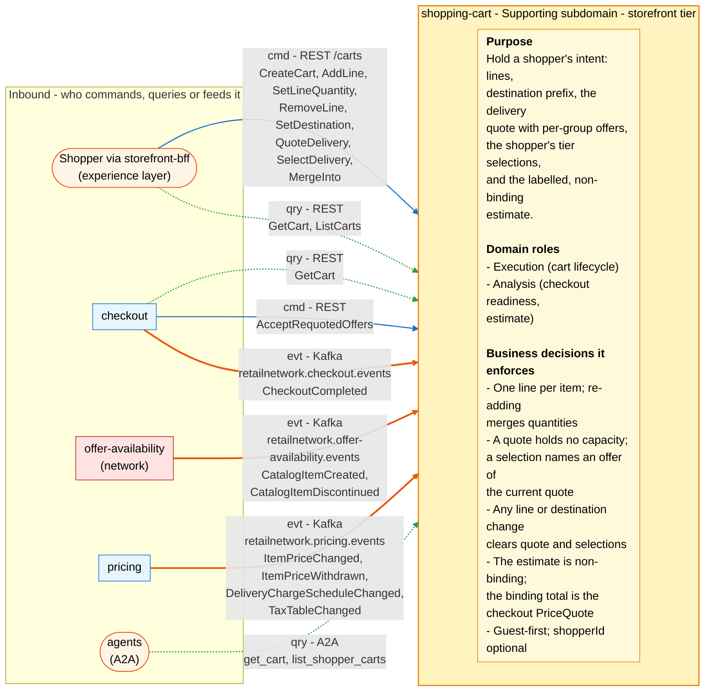
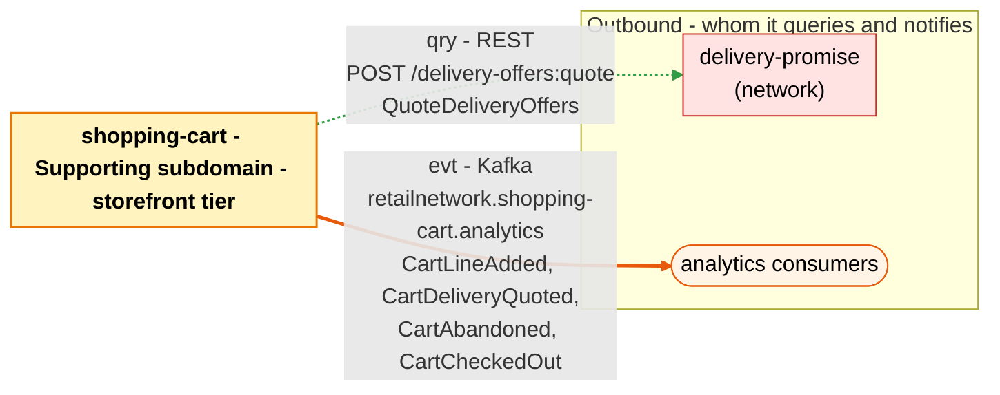

# Bounded context canvas

Following the ddd-crew [Bounded Context Canvas v5](https://github.com/ddd-crew/bounded-context-canvas).
Every message row below exists in the code: the routes in
`internal/adapters/inbound/http/server.go`, the consumed types in
`internal/adapters/inbound/kafka/handlers.go`, the published ones in
`internal/adapters/outbound/kafka/encoder.go` and the single outbound call in
`internal/adapters/outbound/deliverypromise/gateway.go`.

## Canvas at a glance

Arrows follow the message type: **solid blue** commands (`cmd`), **dotted green**
queries (`qry`), **thick orange** events (`evt`). Box shapes mark the collaborator
kind: rounded = people, UI or any client; blue = sibling bounded context; red =
network context. The Inbound and Outbound Communication tables carry the exact
route, topic and CloudEvents type for every message.

### Inbound

Source: `internal/adapters/inbound/http/server.go` (routes),
`internal/adapters/inbound/a2a/skills.go` (skills),
`internal/adapters/inbound/kafka/handlers.go` and `handlers_pricing.go` (consumed
types), `internal/domain/cart/cart.go` (the invariants in the card).

### Outbound

Source: `internal/adapters/outbound/deliverypromise/gateway.go` (`quotePath`),
`internal/adapters/outbound/kafka/encoder.go` (`Topic`, `payloadFor`).

The synchronous replies to the BFF and checkout, and the `QuoteDeliveryOffers`
response, are the only synchronous traffic.

## Name

**Shopping Cart** (`shopping-cart`, code `SC`, CloudEvents tier `storefront`).

## Purpose

To hold a shopper's intent. The context:

- keeps one line per catalogue item (re-adding merges quantities), bounded at 100
  lines, purchasable against the local views;
- holds the destination postal prefix, never an address;
- quotes delivery through the network's `delivery-promise` and holds the result:
  one group per shipment, each offer with `offerId`, tier, window and expiry, plus
  the tiers that were unavailable;
- holds the shopper's selection, one offer per group, and clears quote and
  selections on any line or destination change;
- computes the labelled, non-binding estimate (effective prices plus selected tier
  charges plus tax band) so the total cost is visible up front; the binding total
  is the checkout session's `PriceQuote`.

## Strategic classification

| Axis | Verdict |
| --- | --- |
| **Domain** | **Supporting** subdomain. See the [Core domain chart](/docs/ddd/core-domain-chart). |
| **Business model** | Conversion (holding intent without losing the total-cost-up-front rule). |
| **Evolution** | Custom-built. |

## Domain roles

| Role | Applies? | Evidence in the code |
| --- | --- | --- |
| **Execution (cart lifecycle)** | **Yes, primary** | The `Cart` aggregate: `Create` through `CloseOnCheckoutCompleted`, with `ErrCartClosed` guarding the terminal states. |
| **Analysis (checkout readiness, estimate)** | **Yes** | `Cart.Readiness` ("every group selected, no offer expired") and `estimate.Compute`. |
| Specification | No | Prices, charges and tax bands are pricing's specification; the cart only projects them. |
| Enforcer | No | The enforcer roles sit in `checkout` and `customer-payments`. |

## Inbound communication

| Collaborator | Message | Type | Channel | Relationship |
| --- | --- | --- | --- | --- |
| Shopper via `storefront-bff` | `CreateCart` | Command | REST `POST /carts` | UI |
| Shopper via `storefront-bff` | `AddLine` | Command | REST `POST /carts/{cartId}/lines` | UI |
| Shopper via `storefront-bff` | `SetLineQuantity` | Command | REST `POST /carts/{cartId}/lines/{catalogItemId}:set-quantity` | UI |
| Shopper via `storefront-bff` | `RemoveLine` | Command | REST `POST /carts/{cartId}/lines/{catalogItemId}:remove` | UI |
| Shopper via `storefront-bff` | `SetDestination` | Command | REST `POST /carts/{cartId}:set-destination` | UI |
| Shopper via `storefront-bff` | `QuoteDelivery` | Command | REST `POST /carts/{cartId}:quote-delivery` | UI |
| Shopper via `storefront-bff` | `SelectDelivery` | Command | REST `POST /carts/{cartId}:select-delivery` | UI |
| Shopper via `storefront-bff` | `MergeInto` | Command | REST `POST /carts/{cartId}:merge-into` | UI |
| `checkout` | `AcceptRequotedOffers` | Command | REST `POST /carts/{cartId}/delivery/requoted` | Customer/Supplier (we are the Supplier); served, no caller found yet |
| Shopper via `storefront-bff` | `GetCart` | Query | REST `GET /carts/{cartId}` | UI |
| Shopper via `storefront-bff` | `ListCarts` | Query | REST `GET /carts?shopperId=&state=` | UI |
| `checkout` | `GetCart` | Query | REST `GET /carts/{cartId}` | Customer/Supplier (we are the Supplier) |
| agents | `get_cart`, `list_shopper_carts` | Query | A2A JSON-RPC, `cmd/a2a` | Open Host Service for agents |
| `offer-availability` (network) | `CatalogItemCreated` | Event | Kafka `retailnetwork.offer-availability.events`, `com.retailnetwork.commerce.offer-availability.catalogitem.CatalogItemCreated` | Conformist |
| `offer-availability` (network) | `CatalogItemDiscontinued` | Event | same topic, `...catalogitem.CatalogItemDiscontinued` | Conformist |
| `pricing` | `ItemPriceChanged` | Event | Kafka `retailnetwork.pricing.events`, `com.retailnetwork.storefront.pricing.itemprice.ItemPriceChanged` | Customer/Supplier (we are the Customer) |
| `pricing` | `ItemPriceWithdrawn` | Event | same topic, `...itemprice.ItemPriceWithdrawn` | Customer/Supplier (Customer) |
| `pricing` | `DeliveryChargeScheduleChanged` | Event | same topic, `com.retailnetwork.storefront.pricing.deliverychargeschedule.DeliveryChargeScheduleChanged` | Customer/Supplier (Customer) |
| `pricing` | `TaxTableChanged` | Event | same topic, `com.retailnetwork.storefront.pricing.taxtable.TaxTableChanged` | Customer/Supplier (Customer) |
| `checkout` | `CheckoutCompleted` | Event | Kafka `retailnetwork.checkout.events`, `com.retailnetwork.storefront.checkout.checkoutsession.CheckoutCompleted` | Customer/Supplier (we are the Customer) |

## Outbound communication

| Collaborator | Message | Type | Channel | Relationship |
| --- | --- | --- | --- | --- |
| `delivery-promise` (network) | `QuoteDeliveryOffers` | Query | REST `POST /delivery-offers:quote` | Open Host Service (the network publishes it); we are the Customer |
| analytics only | `CartLineAdded` | Event | Kafka `retailnetwork.shopping-cart.analytics`, `com.retailnetwork.storefront.shopping-cart.cart.CartLineAdded` | analytics stream |
| analytics only | `CartDeliveryQuoted` | Event | same topic, `...cart.CartDeliveryQuoted` | analytics stream |
| analytics only | `CartAbandoned` | Event | same topic, `...cart.CartAbandoned` | analytics stream |
| analytics only | `CartCheckedOut` | Event | same topic, `...cart.CartCheckedOut` | analytics stream |

Nobody in the storefront or the network consumes a cart event: all four are
analytics-only. `checkout` takes the cart by the synchronous read instead.
Relationship evidence: [Context map](/docs/ddd/context-map).

## Ubiquitous language

Full glossary: [Ubiquitous language](/docs/ddd/ubiquitous-language). Top terms:
**Cart**, **Delivery Quote** (a set of offers; not the network's one
`DeliveryOffer`), **Delivery Selection**, **Estimate** (non-binding; not the
checkout session's `PriceQuote`), **Checkout Readiness**.

## Business decisions

1. **One line per item; adding an item already in the cart merges quantities.**
   There is no duplicate-line error: `Cart.AddLine` merges and bounds the merged
   quantity.
2. **A quote holds no capacity.** It is exactly the set of offers `delivery-promise`
   returned; a selection must name an offer of the current quote
   (`ErrStaleDeliverySelection`).
3. **Any line or destination change clears the quote and the selections.**
4. **The estimate is labelled non-binding; the binding total is the checkout
   session's `PriceQuote`.**
5. **Guest-first**: `shopperId` is optional; `MergeInto` unifies a guest cart with
   the shopper's open cart (`ErrMergeTarget`).
6. **A cart is bounded and checked**: quantity in 1 to 99 (`ErrQuantityOutOfRange`),
   at most 100 lines (`ErrTooManyLines`), the item purchasable in the local views
   (`ErrItemNotPurchasable`).
7. **A closed cart never changes** (`ErrCartClosed`): `CHECKED_OUT`, `ABANDONED` and
   `MERGED` are terminal.

## Assumptions

- The BFF mints the `Idempotency-Key` for every `/carts` write and keeps the cart id
  in a cookie, which is state and not authentication.
- `QuoteDeliveryOffers` returns the group shape the cart stores. Only offers in
  state `QUOTED` are kept.
- Offer expiry is enforced locally: readiness compares `expiresAt` with the clock,
  because no event announces an offer's expiry.
- The estimate tolerates event lag; pricing's binding answer comes later, at the
  checkout quote.
- Every consumed event is applied once (inbox on the CloudEvents `id`), and
  consumers dispatch on the full type string.
- One configured currency everywhere (`CART_CURRENCY` is the fallback before any
  price states one); money appears in the cart only inside the estimate.

## Verification metrics

What exists today versus what would be proposed:

| Metric | Source today |
| --- | --- |
| Share of `AddLine` rejected `item-not-purchasable`, and rejections by reason | OTel counter `cart.lines.added` (`outcome`, `reason`), dashboard `warehouse-shopping-cart` |
| REST success, 5xx ratio and latency | `http.server.request.duration`, Kong metrics, the `warehouse-shopping-cart` alert groups |
| `quote-delivery` failures | access log `http request` lines with route `/carts/{cartId}:quote-delivery` and status 503 |
| `OPEN` carts older than 30 days after the sweep | `carts.last_changed_at` against `AbandonInactive` |
| Oldest unpublished outbox event | `outbox_events.created_at` where `published_at IS NULL` (no metric yet) |
| View lag behind the topics | consumer-group lag from the broker (no metric yet) |

## Open questions

- **Only some commands publish.** `CartLineAdded`, `CartDeliveryQuoted`,
  `CartAbandoned` and `CartCheckedOut` are the whole stream; removal, quantity
  changes, destination, selection, merge and creation raise nothing, so analytics
  sees adds, quotes, abandons and checkouts but never a removal or a merge
  (hotspot H1 on [EventStorming](/docs/ddd/eventstorming)).
- **`PurchasabilityView` is narrower than discovery's verdict.** Its sources are
  catalogue and price events only (`Item.Purchasable`: catalogued, not
  discontinued, priced); `product-discovery`'s `Purchasable` also requires content
  and a live listing with stock. The cart can accept an item discovery would
  refuse; checkout's quote is the gate (hotspot H3).
- **Nobody consumes a cart event.** Whether any sibling should consume a cart fact
  is undecided (hotspot H4).
- **`AcceptRequotedOffers` has no caller yet** in the local checkouts of `checkout`
  and `storefront-bff`.
