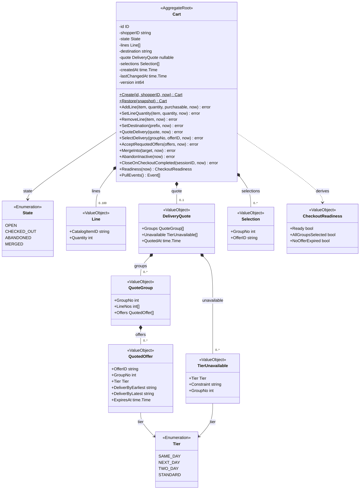
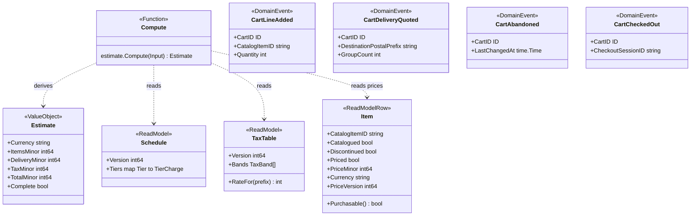
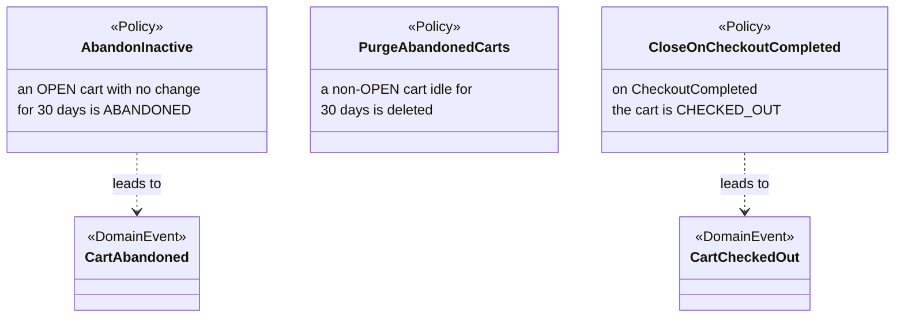
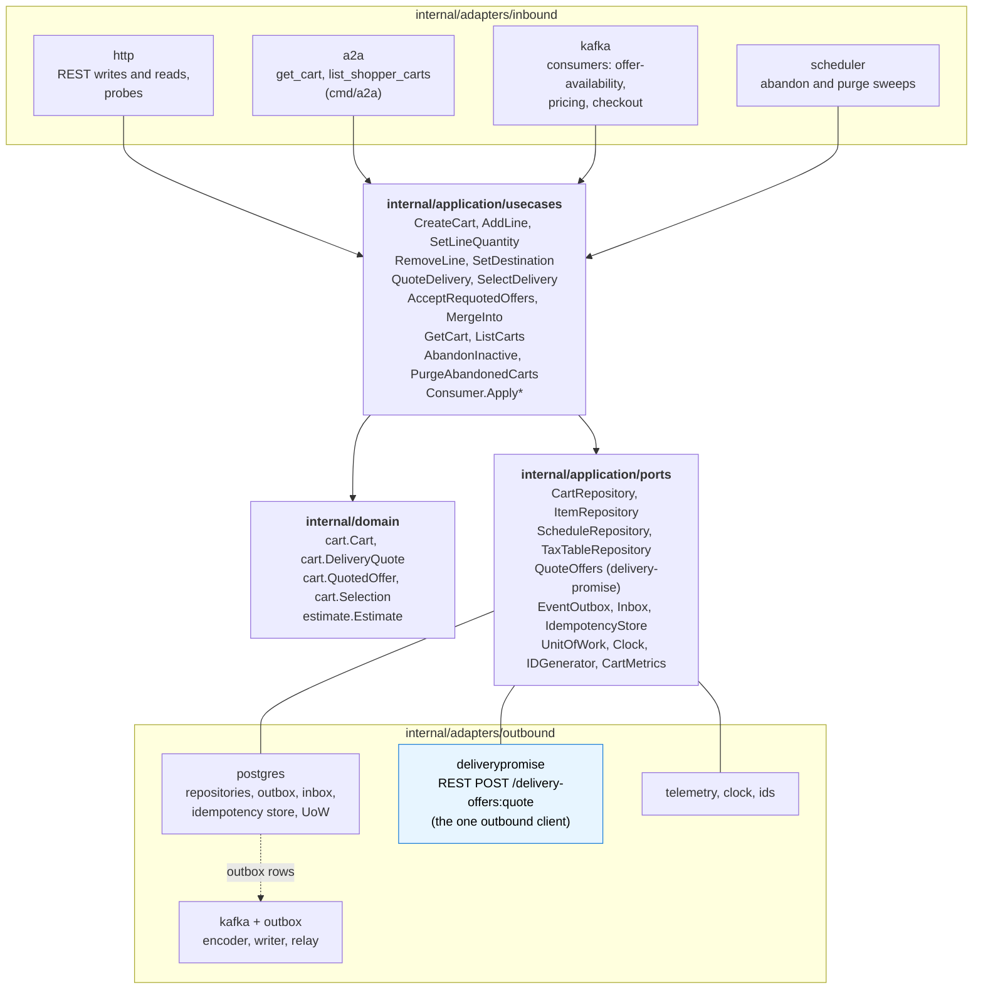

# Class diagrams

UML class diagrams of the `internal/domain/**` packages as built, plus the
hexagonal ports and adapters. Fields are unexported in Go and shown with `-`;
methods are shown with `+`. Exported domain types: package `cart`: `ID`, `State`,
`Line`, `Cart`, `CheckoutReadiness`, `Tier`, `QuotedOffer`, `QuoteGroup`,
`TierUnavailable`, `DeliveryQuote`, `Selection`, `Snapshot` and the four events
`CartLineAdded`, `CartDeliveryQuoted`, `CartAbandoned`, `CartCheckedOut`; package
`estimate`: `TierCharge`, `Schedule`, `TaxBand`, `TaxTable`, `Group`, `Input`,
`Estimate`. The identifiers are on [Ubiquitous language](/docs/ddd/ubiquitous-language).

## 1. The Cart aggregate and its held quote

Source: `internal/domain/cart/cart.go`, `lines.go`, `delivery.go`, `quote.go`,
`lifecycle.go`, `requote.go`, `restore.go`.

Omitted: the `Err...` variables (listed on the
[Aggregate design canvas](/docs/ddd/aggregate-design-canvas)) and the quote
clearing, which every mutating line or destination method performs. `Tier` is the
delivery-promise vocabulary, re-declared locally: there is no shared kernel.

## 2. Estimate, read models, events and policies

Source: `internal/domain/estimate/estimate.go`,
`internal/application/readmodel/readmodel.go`,
`internal/domain/cart/events.go`, `internal/application/usecases/policies.go`,
`consume.go`.

Omitted: the CloudEvents envelope (built in the Kafka adapter). Every event also
embeds `shared.Header` (the aggregate version after the change and the instant).
The estimate is never stored: `estimate.Compute` derives it at read time and the
cart view labels it non-binding through `Complete`.

## 3. Hexagonal ports and adapters

Source: `internal/application/ports/ports.go`, `cmd/api/main.go`
(`buildAdapters`, `startConsumers`, `startOutboxRelay`, `startSchedulers`),
`cmd/a2a/main.go` (`buildDeps`),
`internal/adapters/outbound/deliverypromise/gateway.go`.

The **only outbound REST client** is the `deliverypromise` adapter behind the
`QuoteOffers` port. Omitted: the composition roots and the in-memory test double.
The scheduler is an inbound adapter: time triggers `AbandonInactive` and
`PurgeAbandonedCarts`. `GetCart` and `ListCarts` are use cases over the same
repositories; `cmd/a2a` wires only those two.
