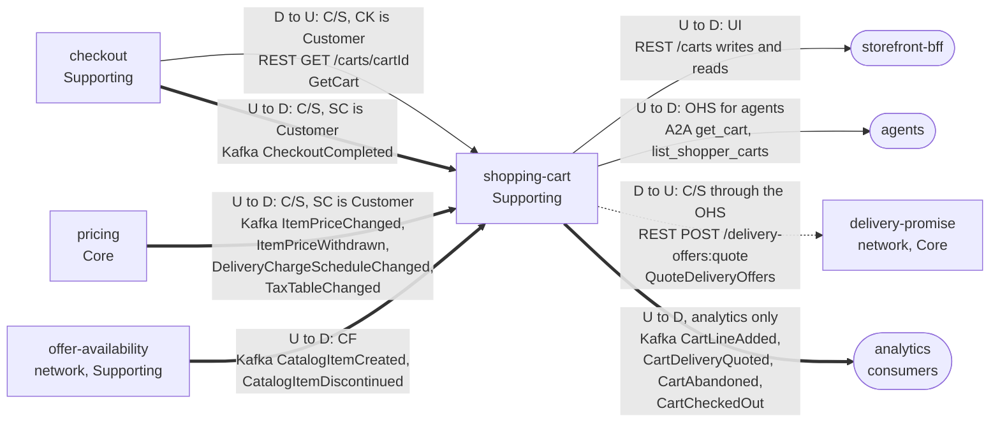

# Context map

Following ddd-crew [Context Mapping](https://github.com/ddd-crew/context-mapping).
This is **shopping-cart's slice** of the storefront-wide context map
([warehouse-docs](https://iqvo.github.io/warehouse-docs/storefront/strategic-design/context-map)):
every relationship this context has, with the upstream (U) and downstream (D)
side, the pattern and the channel.

Source: `internal/adapters/inbound/http/server.go` (routes),
`internal/adapters/inbound/a2a/server.go` (skills),
`internal/adapters/inbound/kafka/handlers.go` (consumed topics),
`internal/adapters/outbound/kafka/encoder.go` (`Topic`),
`internal/adapters/outbound/deliverypromise/gateway.go` (`quotePath`) and, for the
caller side, `checkout/internal/adapters/outbound/shoppingcart/gateway.go`
(`GET /carts/{cartId}`).

Legend: arrows point from upstream to downstream, except the REST read drawn with
the caller on the left and the quote call (both labelled with the true direction). A
solid arrow is a synchronous relationship, a thick arrow is a Kafka event
relationship and the dotted arrow is the cart's one outbound query. The path
parameter `{cartId}` is written `cartId` inside the diagram.

Omitted, because they have no edge with this context (**Separate Ways**):
`product-content` (the cart consumes no content events), `product-discovery` (the
cart never queries discovery; both keep their own purchasability verdicts),
`customer-payments` (it learns totals from `checkout`, never from the cart), and
the whole network except `offer-availability` and `delivery-promise`: the cart never
calls `customer-ordering` (reaching it is checkout's job) and never touches a
`warehouse.*` topic.

## Relationships

| Neighbour | Direction | Pattern | Channel | Messages | Why this pattern |
| --- | --- | --- | --- | --- | --- |
| `storefront-bff` (experience layer) | cart upstream, BFF downstream | **UI** | REST `/carts` writes, `GET /carts/{cartId}`, `GET /carts?shopperId=&state=` | `CreateCart`, `AddLine`, `SetLineQuantity`, `RemoveLine`, `SetDestination`, `QuoteDelivery`, `SelectDelivery`, `MergeInto`; `GetCart`, `ListCarts` | The BFF is the only storefront edge; it mints the `Idempotency-Key` and keeps cart ids in a cookie. The cart is the system of record for the intent. |
| `checkout` (Supporting) | cart upstream, checkout downstream | **Customer/Supplier** (checkout is the Customer) | REST `GET /carts/{cartId}` | `GetCart` | Checkout reads cart and version plus `checkoutReadiness` inside the shopper's session-open request. |
| `checkout` (Supporting) | cart upstream, checkout downstream | **Customer/Supplier** (checkout is the Customer) | REST `POST /carts/{cartId}/delivery/requoted` | `AcceptRequotedOffers` | The route exists for checkout's requote; no caller was found in the local checkouts. |
| `checkout` (Supporting) | checkout upstream, cart downstream | **Customer/Supplier** (SC is the Customer) | Kafka `retailnetwork.checkout.events` | `CheckoutCompleted` | The cart closes itself (`CloseOnCheckoutCompleted`) on the fact, instead of checkout calling back synchronously. |
| `pricing` (Core) | pricing upstream, SC downstream | **Customer/Supplier** (SC is the Customer) | Kafka `retailnetwork.pricing.events` | `ItemPriceChanged`, `ItemPriceWithdrawn`, `DeliveryChargeScheduleChanged`, `TaxTableChanged` | The estimate's inputs come by event so the cart never blocks on a synchronous price read. |
| `offer-availability` (network, Supporting) | OA upstream, SC downstream | **Conformist** | Kafka `retailnetwork.offer-availability.events` | `CatalogItemCreated`, `CatalogItemDiscontinued` | The catalogue facts are taken as published into the purchasability view; the cart never redefines the item. |
| `delivery-promise` (network, Core) | DP upstream, SC downstream | **Open Host Service** (network side) with a conformist consumer | REST `POST /delivery-offers:quote` | `QuoteDeliveryOffers` (query) | The network publishes the route; the cart consumes the offer set as returned (windows, tiers, expiries, unavailable tiers) and adds nothing. |
| agents | cart upstream, agents downstream | **Open Host Service** | A2A JSON-RPC on `cmd/a2a` | `get_cart`, `list_shopper_carts` | Read-only delegation channel, ADR 0006. |
| analytics consumers | cart upstream, analytics downstream | analytics stream | Kafka `retailnetwork.shopping-cart.analytics` | `CartLineAdded`, `CartDeliveryQuoted`, `CartAbandoned`, `CartCheckedOut` | Funnel facts only; no storefront or network context consumes a cart event today. |

## Notes on the patterns

- **No Anti-Corruption Layer.** Both network edges arrive on the organisation's own
  terms: the event feed is the standard CloudEvents shape, and the quote route is an
  Open Host Service. The only ACL in the storefront design is checkout's outbound
  adapter toward `customer-ordering`, not the cart. The cart does translate: the
  delivery-promise client (`deliverypromise.toQuote`) keeps only `QUOTED` offers and
  converts windows to calendar dates in the destination's zone.
- **No Shared Kernel.** The service-tier enum is re-declared inside `QuotedOffer`;
  `catalogItemId` and `offerId` are values copied from messages, never shared code.
- **One synchronous call out.** Exactly `QuoteDeliveryOffers`, the one moment a user
  request needs an answer the cart cannot have ahead of time.
- **The cart is a dead end for events.** All four published events are
  analytics-only; checkout reads the cart synchronously instead.
- **The quote crosses two contexts without leaving a trail.** The offers in the cart
  are `delivery-promise` facts frozen at quote time; expiry is enforced locally by
  comparing `expiresAt`.
- **No warehouse-systems edge.** The cart never produces or consumes a `warehouse.*`
  topic.
