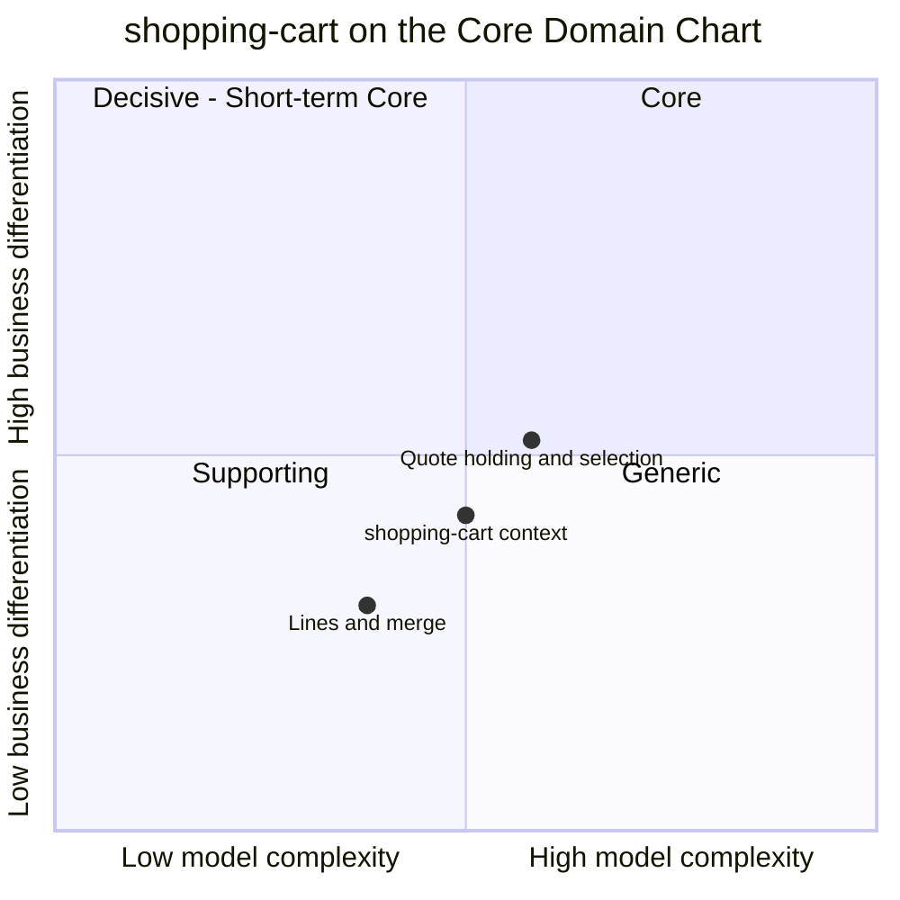

# Core domain chart

Following the ddd-crew [Core Domain Charts](https://github.com/ddd-crew/core-domain-charts):
business differentiation (y) against model complexity (x). The storefront-wide
classification is on
[Subdomain classification](/docs/ddd/subdomain-classification).

Source: the point `[0.50, 0.42]` is the aggregator model's chart entry for this
context (`complexity: 0.50`, `differentiation: 0.42`,
[storefront Subdomain Classification](https://iqvo.github.io/warehouse-docs/storefront/strategic-design/subdomain-classification));
the two slices are placed by judgement over `internal/domain/cart`
(`quote.go`, `delivery.go`, `lines.go`, `lifecycle.go`) and
`internal/domain/estimate/estimate.go`.

## Classification: Supporting

The context point sits in **quadrant 3 (Supporting)**; the quote slice grazes the
Core boundary without crossing it. A shopper does not choose this storefront
because of its cart; a broken cart, however, loses the sale all the same. It must
work, and working is not the differentiator.

**Differentiation is moderate (y = 0.42).**

- The **quote-and-selection shape** (one group per shipment, an offer with a
  window and expiry per tier, the shopper picks one, any change clears both) is
  specific to this network's promise model. A generic cart package cannot hold it;
  that is why the slice sits highest.
- The **labelled, non-binding estimate** is the cart's half of the
  total-cost-up-front rule, but the differentiated part (the price of speed, the
  binding quote) belongs to pricing.

**Complexity is moderate (x = 0.50).** One aggregate, one root, four states, nine commands and three policies, and rules that are not CRUD:

- The quote introduces **foreign lifecycle**: offers expire by the network's clock,
  and readiness ("every group selected, no offer expired") is a fact about time
  (`Cart.Readiness(now)`), not about stored state.
- **Clearing semantics**: one rule ("any line or destination change clears the
  quote and the selections", `Cart.clearQuote`) touches every mutating command.
- Correctness depends on two upstream feeds: `ErrItemNotPurchasable` is only as
  current as `rm_items`, and the estimate only as current as the schedule and tax
  table.

The **lines and merge** slice is plotted lowest and leftmost: one line per item,
quantity bounds, merge-on-add are careful but conventional conversion plumbing.

## Business model

**Conversion.** The context earns by not losing purchases between the product page
and checkout: keep the intent across sessions (guest-first, merge), keep it honest
(estimate labelled, quote cleared on change), and hand checkout a cart that is
ready.

## Evolution

| Part | Evolution stage | Why |
| --- | --- | --- |
| Cart aggregate with quote and selection | **Custom-built** | Holding the network's per-group offers with clearing semantics is this design's shape. |
| Purchasability and estimate views | **Custom-built** | Projections negotiated with `pricing` and `offer-availability` events; no product to buy. |
| Abandonment and purge policies | **Commodity leaning** | A 30-day inactivity sweep is standard practice; the number is `cart.IdleAfter`. |
| Plumbing (outbox, inbox, CloudEvents, idempotency) | **Commodity** | Fleet-wide building blocks. |

**Movement to watch.** Promotions would raise complexity inside the cart's
estimate before becoming their own context. A deferred identity context would
formalise the merge and `shopperId` handling the cart now owns. The interfaces to
keep stable are the REST surface under `/carts`, the four analytics events and the
two views' event feeds.
