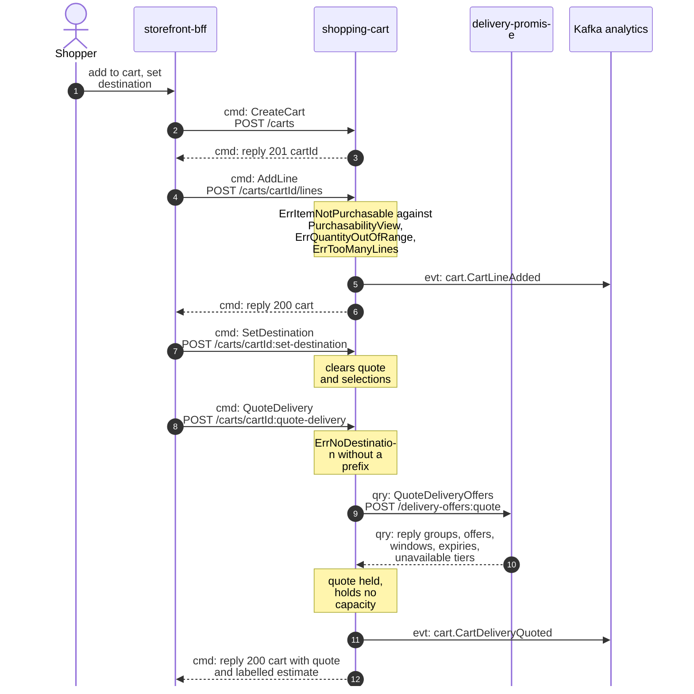
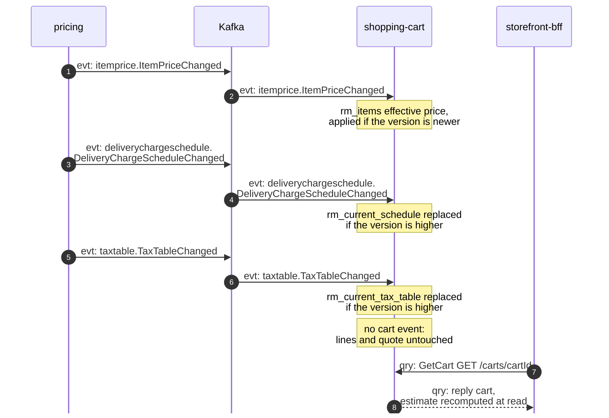
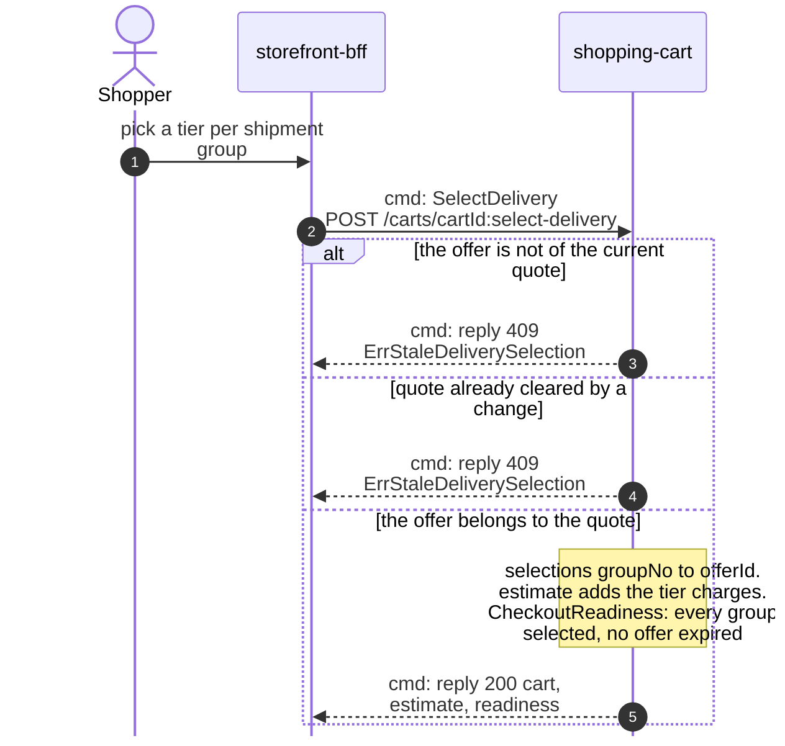
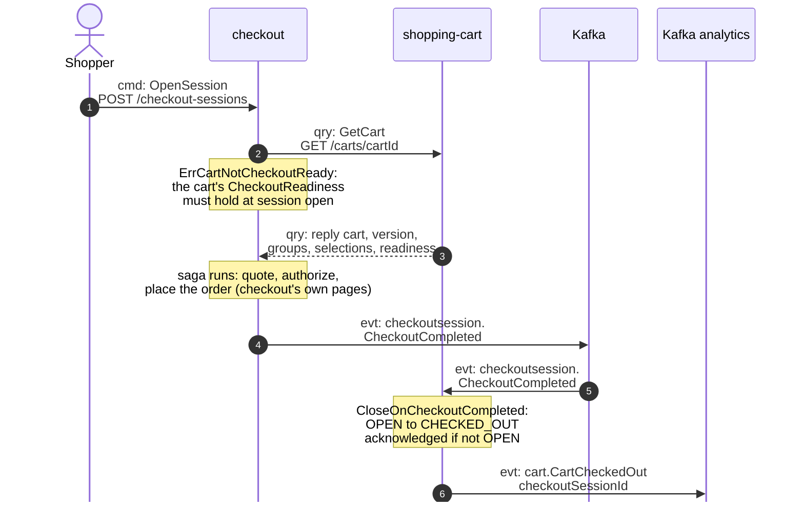

# Domain message flow

Following ddd-crew [Domain Message Flow Modelling](https://github.com/ddd-crew/domain-message-flow-modelling).
Four scenarios. Participants are contexts and actors. Every arrow is a message,
prefixed `cmd:` (command), `qry:` (query) or `evt:` (event). A `Note` names a rule
the context applies. Kafka is drawn as one participant. Event names are written
`entity.EventName`; the full type is
`com.retailnetwork.<tier>.<producer>.<entity>.<EventName>` (see
[Domain events](/docs/ddd/domain-events)). REST path parameters are written without
braces. The storefront-wide flows follow from the
[storefront context map](https://iqvo.github.io/warehouse-docs/storefront/strategic-design/context-map).

## 1. A shopper builds a cart and quotes delivery

Source: `internal/adapters/inbound/http/server.go` (routes),
`internal/application/usecases/cart_commands.go`, `quote_delivery.go`,
`internal/domain/cart/lines.go`, `delivery.go`,
`internal/adapters/outbound/deliverypromise/gateway.go`,
`internal/adapters/outbound/kafka/encoder.go`.

Omitted: the outbox write and relay (see
[Sequence diagrams](/docs/ddd/sequence-diagrams)); the merge of a re-added item's
quantities (the event carries the merged line); `SetLineQuantity`, `RemoveLine` and
`MergeInto`, which share `AddLine`'s shape without its event.

## 2. A price, charge or tax change lands

Source: `internal/adapters/inbound/kafka/handlers_pricing.go`,
`internal/application/usecases/consume.go`,
`internal/application/usecases/view.go` (`estimateFor`).

Omitted: `ItemPriceWithdrawn` (same channel: the item stops being purchasable and
the estimate can no longer price the line) and `CatalogItemCreated` /
`CatalogItemDiscontinued` from offer-availability, which feed `rm_items` the same
way. The quote is never cleared by a price event; only a line or destination change
clears it.

## 3. The shopper selects a delivery offer per group

Source: `internal/domain/cart/delivery.go` (`SelectDelivery`, `hasOffer`,
`Readiness`), `internal/application/usecases/cart_commands.go`,
`internal/domain/estimate/estimate.go`.

Omitted: the expiry comparison (readiness compares each `QuotedOffer`'s `expiresAt`
with the clock; no event announces an expiry) and the estimate arithmetic.

## 4. Checkout reads the cart and completes it

Source: `checkout/internal/adapters/outbound/shoppingcart/gateway.go` (the caller of
`GET /carts/{cartId}`), `internal/application/usecases/consume.go`
(`ApplyCheckoutCompleted`), `internal/domain/cart/lifecycle.go`
(`CloseOnCheckoutCompleted`).

Omitted: the saga itself (pricing's `PriceQuote`, `customer-payments`, the network's
order placement through checkout's anti-corruption layer; checkout's own pages), the
inbox on the CloudEvents `id`, and the offer pre-check checkout runs against
delivery-promise before authorizing, which is checkout's edge, not the cart's.
