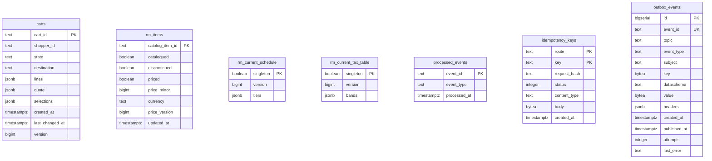

# Entity-relationship diagram

The schema created by
`internal/adapters/outbound/postgres/migrations/0001_shopping_cart_schema.up.sql`,
embedded in the binary and applied at boot with golang-migrate (which adds its own
`schema_migrations` table). Shopping Cart owns its database and shares no table with
another context. There are no foreign keys: the aggregate keeps its lines, quote and
selections inside the `carts` row as `jsonb`, and the other tables are read models
or infrastructure.

Seven tables. Key markers: PK primary key, UK unique.

Source: `internal/adapters/outbound/postgres/migrations/0001_shopping_cart_schema.up.sql`.

## Tables

| Table | Columns | Primary key | Role |
| --- | --- | --- | --- |
| `carts` | 10 | `cart_id` | the Cart aggregate. `state` is checked to `OPEN`, `CHECKED_OUT`, `ABANDONED` or `MERGED`; `version >= 1` is the optimistic-concurrency token. Indexes: `carts_shopper_idx (shopper_id, created_at DESC, cart_id DESC) WHERE shopper_id IS NOT NULL` for the shopper list, `carts_idle_idx (state, last_changed_at)` for the sweeps |
| `rm_items` | 8 | `catalog_item_id` | `PurchasabilityView`: one row per catalogue item. A row may be a stub (`catalogued` false) when a price event arrives first. `price_minor >= 0`; `price_version` guards the price against older events |
| `rm_current_schedule` | 3 | `singleton` | `EstimateView`: the one current delivery charge schedule, `tiers` as `jsonb`, replaced when its `version` is higher. The `singleton` column is checked to be true, so at most one row exists |
| `rm_current_tax_table` | 3 | `singleton` | `EstimateView`: the one current tax table, `bands` as `jsonb`, same rule |
| `processed_events` | 3 | `event_id` | the inbox: one row per consumed CloudEvents `id`; claiming it and applying the effect are one transaction |
| `idempotency_keys` | 7 | `route, key` | the stored first answer per `Idempotency-Key` and route (`request_hash`, `status`, `content_type`, `body`); a record older than 24 hours is treated as absent and overwritten. Index `idempotency_keys_created_idx (created_at)` |
| `outbox_events` | 13 | `id` | the transactional outbox. `event_id` is unique (the CloudEvents id, minted once); `topic`, `key`, `value` and `headers` are what the relay publishes; `published_at` is null until the broker acknowledged; `attempts` and `last_error` feed the attempt cap. Partial index `outbox_events_unpublished_idx (id) WHERE published_at IS NULL` |

## What is inside the `jsonb` columns

| Column | Content |
| --- | --- |
| `carts.lines` | array of `{catalogItemId, quantity}` in cart order |
| `carts.quote` | the held `DeliveryQuote`: groups with their line numbers and offers, unavailable tiers, `quotedAt`; null until quoted |
| `carts.selections` | array of `{groupNo, offerId}` |
| `rm_current_schedule.tiers` | an object keyed by tier, each `{chargeMinor, freeOverMinor}` |
| `rm_current_tax_table.bands` | an array of `{from, to, rateBasisPoints}` |
| `outbox_events.headers` | `content-type` and, when a span was active, `traceparent` / `tracestate` |

Source: `internal/adapters/outbound/postgres/cart_json.go`, `estimate_views.go`,
`outbox.go`, `outbox_trace.go`.

The schema holds no PII and no card data: a shopper is an opaque reference and the
destination is a postal prefix. The invariants are enforced by the aggregate in
`internal/domain` before a row is written; the migration adds CHECK constraints on
scalar columns. The `down` migration drops all seven tables.
