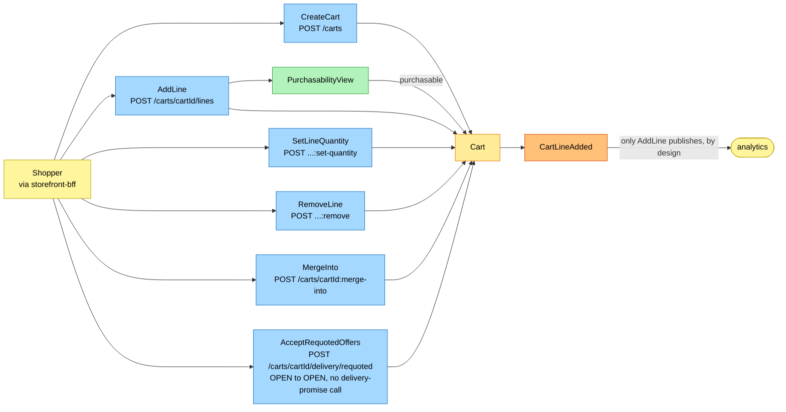
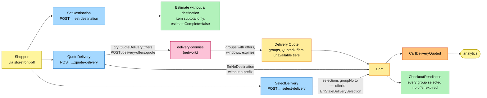
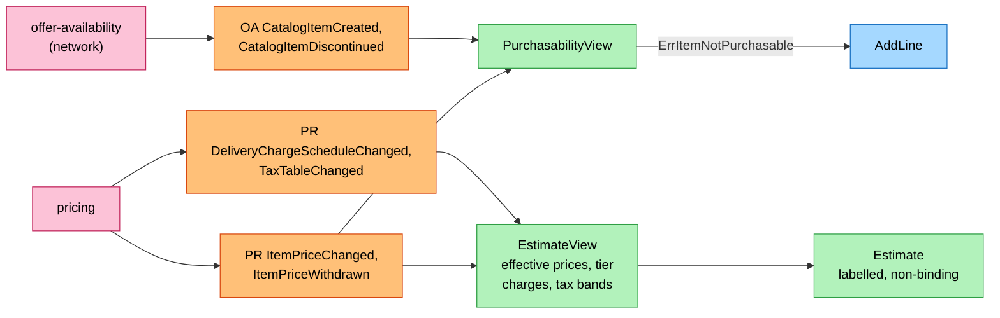
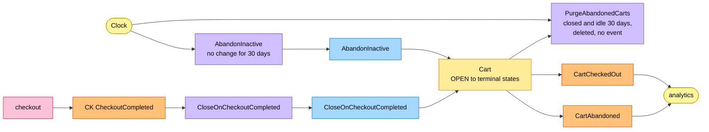

# EventStorming

Process-level boards in the ddd-crew
[EventStorming glossary and cheat sheet](https://github.com/ddd-crew/eventstorming-glossary-cheat-sheet)
notation, reconstructed from the code. Events published by a neighbour are drawn
as orange stickies prefixed with the producer. Every hotspot is a gap or a risk
visible in the design, with its resolution in the code. Boards are drawn left to
right.

## Legend

| Colour | Sticky | Meaning here |
| --- | --- | --- |
| Pale yellow `#fff59d` | Actor | The shopper (through the BFF), the clock |
| Blue `#a5d8ff` | Command | A command of the `Cart` aggregate |
| Yellow `#ffec99` | Aggregate | The `Cart` aggregate and its held quote |
| Orange `#ffc078` | Domain event | Ours (published) or a neighbour's (consumed, prefixed with the producer) |
| Lilac `#d0bfff` | Policy | `AbandonInactive`, `PurgeAbandonedCarts`, `CloseOnCheckoutCompleted` |
| Green `#b2f2bb` | Read model | `PurchasabilityView`, `EstimateView`, `CheckoutReadiness`, a read route |
| Pink `#fcc2d7` | External system | A sibling context or the network (`pricing`, `offer-availability`, `delivery-promise`, `checkout`, analytics) |
| Red `#ff8787` | Hotspot | A gap or risk (see the table at the end) |

## 1. Cart building

Source: `internal/application/usecases/cart_commands.go`,
`internal/domain/cart/lines.go`, `lifecycle.go`, `requote.go`, `events.go`,
`internal/application/readmodel/readmodel.go` (`Item.Purchasable`).

Omitted: the invariant errors on the add path (`ErrQuantityOutOfRange`,
`ErrTooManyLines`, `ErrItemNotPurchasable`, `ErrCartClosed`, `ErrMergeTarget`) and
the outbox. Adding an existing item merges quantities into the one line; nothing is
rejected as a duplicate. Only `AddLine` publishes, by design: analytics needs add,
quote, abandon and checkout. Every mutating command on this board clears the quote
and the selections, and `AcceptRequotedOffers` replaces them with the supplied
offers (each selected) without calling delivery-promise; checkout re-verifies the
offers before authorizing.

## 2. Destination, quote and selection

Source: `internal/application/usecases/quote_delivery.go`,
`internal/domain/cart/delivery.go` and `quote.go`,
`internal/adapters/outbound/deliverypromise/mapping.go`,
`internal/domain/estimate/estimate.go` (`Compute`: no destination returns after
the item subtotal).

Before a destination is set the estimate shows the item subtotal only with
`estimateComplete=false`; the delivery charge and tax appear once a destination
exists. A quote holds no capacity: the offers are delivery-promise facts frozen at
quote time.

## 3. The estimate and the views

Source: `internal/application/usecases/consume.go`,
`internal/adapters/inbound/kafka/handlers.go` and `handlers_pricing.go`,
`internal/application/usecases/view.go`.

The cart is lenient by design: it accepts any catalogued, priced, non-discontinued
item, and checkout's binding quote is the gate. No pricing or catalogue event
touches the `Cart` aggregate: a price move never clears a quote, it moves the
estimate, which is why the estimate is labelled non-binding.

## 4. Cart lifecycle

Source: `internal/application/usecases/policies.go`, `consume.go`
(`ApplyCheckoutCompleted`), `internal/domain/cart/lifecycle.go` (`IdleAfter`,
`AbandonInactive`, `CloseOnCheckoutCompleted`),
`internal/adapters/inbound/scheduler/scheduler.go`.

Omitted: `MergeInto` (board 1) and the inbox. `CHECKED_OUT`, `ABANDONED` and
`MERGED` are terminal: `ErrCartClosed` rejects every later change. A
`CheckoutCompleted` for a cart that is not `OPEN` has no transition; it is
acknowledged and logged.

## Hotspots

| # | Hotspot | Resolution in the code |
| --- | --- | --- |
| H1 | Only `AddLine` (plus the quote, abandon and checkout transitions) publishes; removals, quantity changes, destination changes, selections and merges raise nothing. | By design: analytics needs add, quote, abandon and checkout. `internal/domain/cart/cart.go` documents it ("Removal, merge and quantity changes raise no event, by design"). |
| H2 | Adding an existing item: duplicate error or merge? | Merge. There is no duplicate-line error; the merged quantity must stay in 1 to 99 (`Cart.AddLine`). |
| H3 | `PurchasabilityView` is narrower than discovery's `Purchasable`. | Lenient by design (`readmodel.Item.Purchasable`: catalogued, not discontinued, priced); checkout's price quote is the gate. |
| H4 | No cart consumer exists. | All four events are analytics-only; checkout reads the cart synchronously. Undecided whether a sibling should ever consume one. |
| H5 | Who purges abandoned carts? | The policy `PurgeAbandonedCarts` (scheduler, every `PURGE_SWEEP_INTERVAL`) deletes non-open carts idle for 30 days; it raises no event. |
| H6 | The estimate before a destination exists. | The item subtotal only, `estimateComplete=false`; delivery and tax appear once a destination is set. |
| H7 | `AcceptRequotedOffers` has no caller. | The route is served and tested; no caller was found in the local checkouts of `checkout` and `storefront-bff`. |
