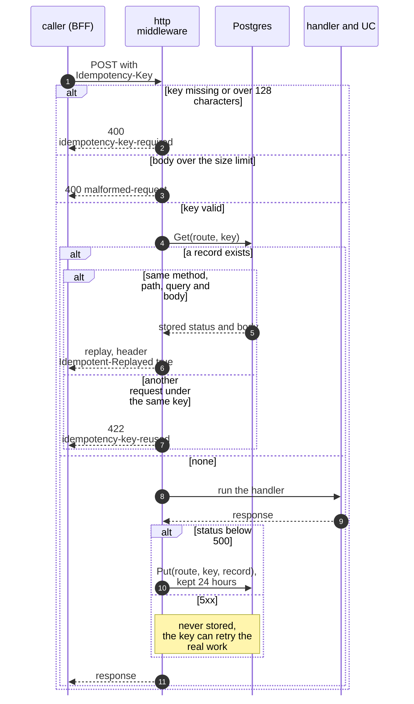
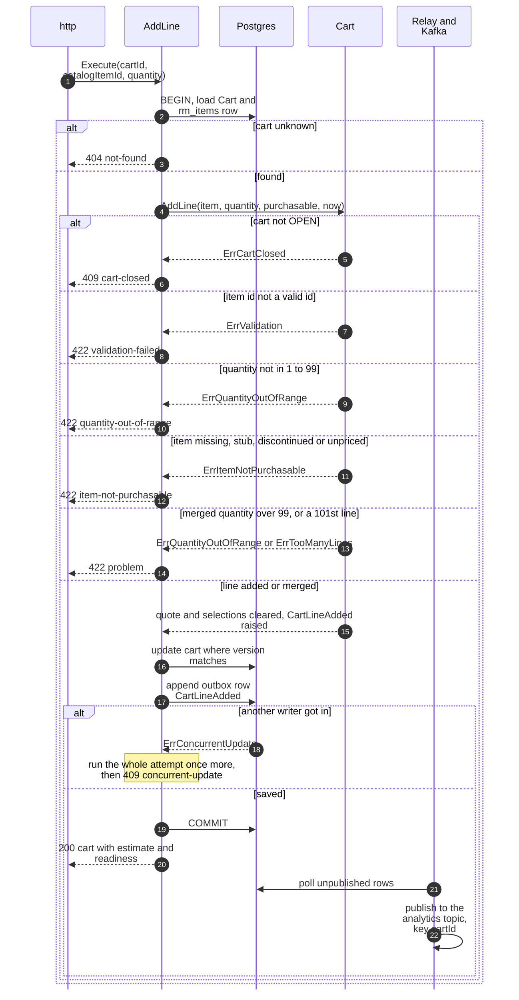
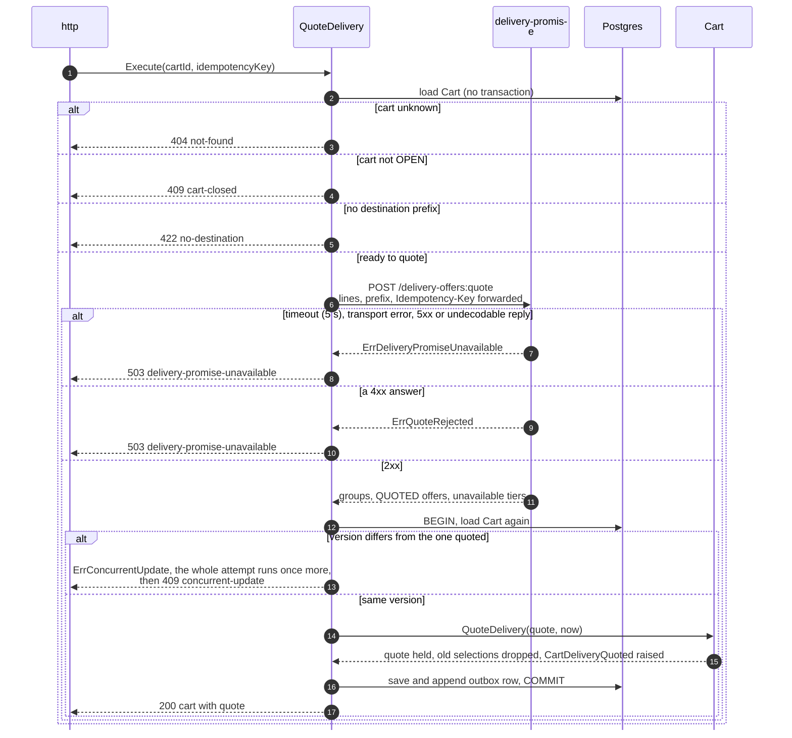
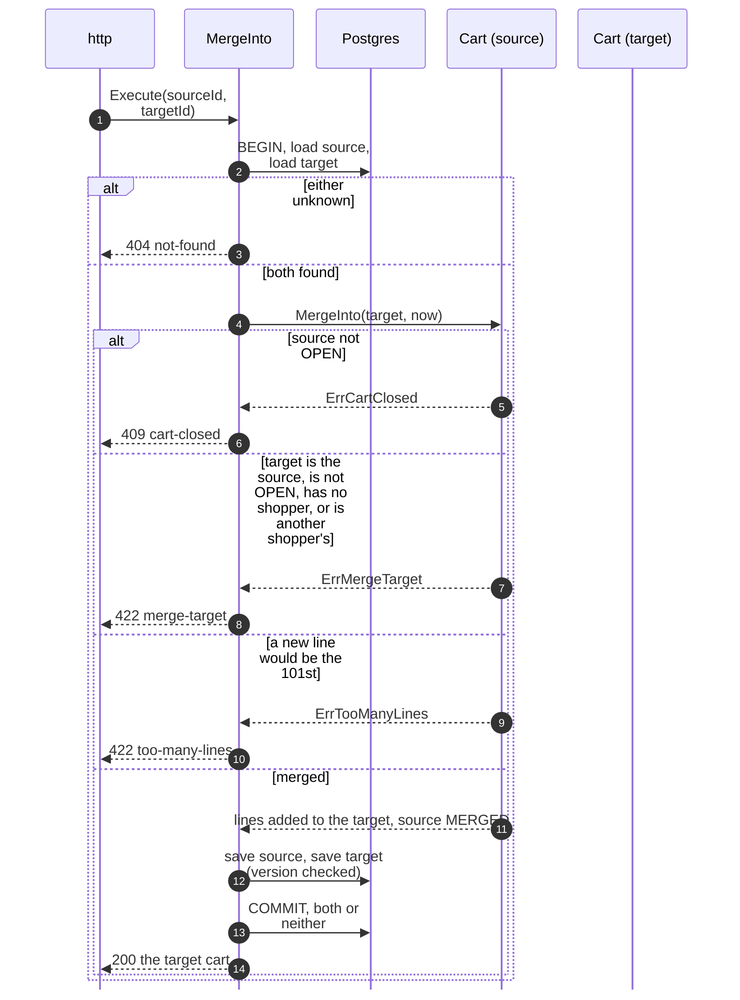
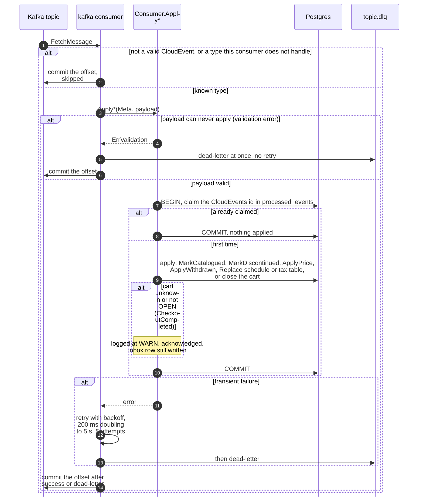
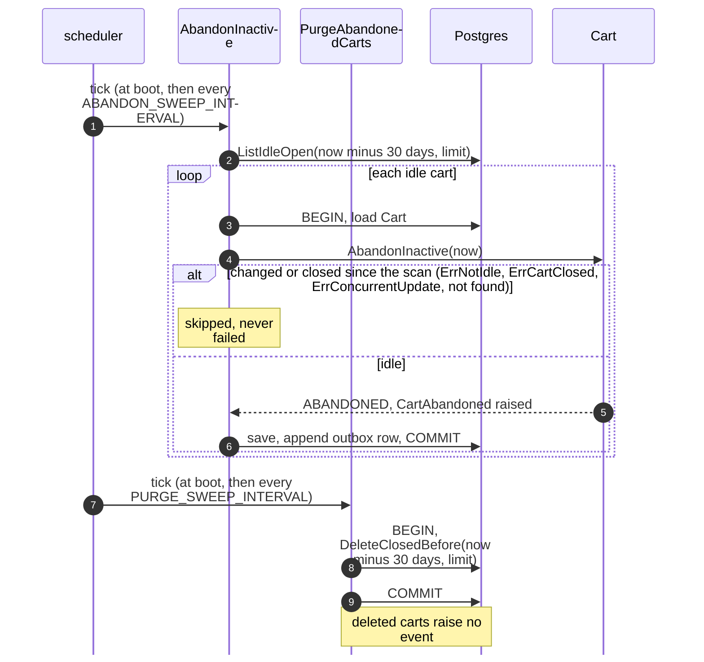
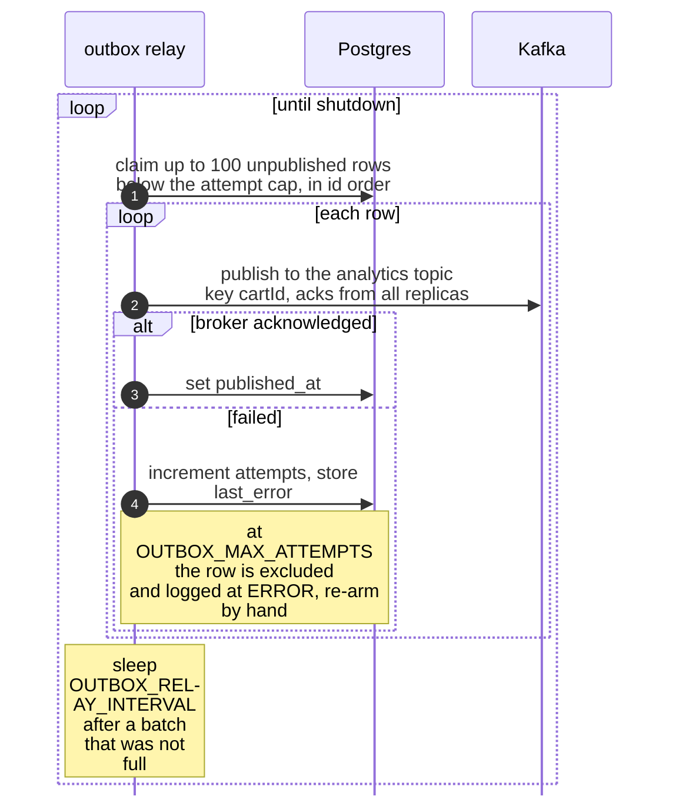

# Sequence diagrams

One diagram per distinct shape of the code, traced from the adapters through the
use cases to Postgres and Kafka. Participants are the packages as built:

- `http` is `internal/adapters/inbound/http` (chi router, the Idempotency-Key
  middleware, the problem mapper in `errors.go`).
- `UC` is a use case in `internal/application/usecases`; `Cart` is the aggregate in
  `internal/domain/cart`.
- `Postgres` stands for the repositories, the outbox, the inbox and the idempotency
  store. Inside a use case they share one transaction through `ports.UnitOfWork`.
- `delivery-promise` is the one outbound REST client (`deliverypromise.Gateway`).
- `Relay` is the outbox relay and `Kafka` the broker.

Every command follows one shape inside a unit of work: load the aggregate, call the
domain, save it with its `version` checked, append the raised events to the outbox,
return the view (`Deps.persist`, `mutate` in `cart_commands.go`). A save that lost a
race returns `ports.ErrConcurrentUpdate` and the whole attempt runs again on fresh
state: `commandAttempts = 2` for commands, `consumerAttempts = 5` for consumed
events; then `409 concurrent-update`. Event types are on
[Domain events](/docs/ddd/domain-events).

## 1. The idempotent write path (every `POST`)

All nine `POST` routes pass through `RequireIdempotencyKey` first.

Source: `internal/adapters/inbound/http/idempotency.go`, `errors.go`,
`server.go` (`idempotent`, the nine routes).

Omitted: the NUL-byte guard that runs before the middleware
([Troubleshooting](/docs/operations/troubleshooting)). A stored response includes a
4xx (a rejected `AddLine` replays as the same 422). Two concurrent first requests
may both run; the store keeps the first record.

## 2. AddLine (`POST /carts/{cartId}/lines`)

Source: `internal/application/usecases/cart_commands.go` (`AddLine`, `mutate`),
`deps.go` (`transact`, `persist`), `internal/domain/cart/lines.go`,
`internal/adapters/inbound/http/errors.go`.

The use case also records the outcome in the `cart.lines.added` counter (`outcome`,
`reason`). `SetLineQuantity`, `RemoveLine`, `SetDestination`, `SelectDelivery` and
`AcceptRequotedOffers` have the same shape through `mutate`; they differ in the
domain call, they raise no event, and a missing line is `404 not-found`
(`ErrLineNotFound`). `SelectDelivery` fails with `409 stale-delivery-selection` when
the offer is not in the current quote, `SetDestination` with `422 validation-failed`
for a prefix that is not 1 to 10 letters or digits.

## 3. QuoteDelivery (`POST /carts/{cartId}:quote-delivery`)

The remote call runs outside any transaction.

Source: `internal/application/usecases/quote_delivery.go`,
`internal/adapters/outbound/deliverypromise/gateway.go`
(`DefaultTimeout`, the error classes), `internal/adapters/inbound/http/errors.go`.

A rejected quote (4xx) maps to the same `503` as an unavailable one, with the detail
telling the caller to retry with the same `Idempotency-Key`. The lines and the
prefix are kept in both cases; no quote is stored.

## 4. MergeInto (`POST /carts/{cartId}:merge-into`)

Source: `internal/application/usecases/cart_commands.go` (`MergeInto`),
`internal/domain/cart/lifecycle.go`.

Neither save publishes an event. The target's quote and selections are cleared too.
Quantities of an item present in both carts are summed and clamped at 99 (`min(...,
MaxQuantity)`), not rejected.

## 5. Consuming an event (pricing, offer-availability, checkout)

Source: `internal/adapters/inbound/kafka/consumer.go` (`HandleMessage`, `Run`),
`deadletter.go`, `handlers.go`, `handlers_pricing.go`,
`internal/application/usecases/consume.go` (`Consumer.handle`).

For a `CheckoutCompleted` that closes an `OPEN` cart, `CartCheckedOut` is appended to
the outbox in the same transaction. A price, schedule or tax table event is applied
only if its `version` is newer than the stored one. Discontinuing an item does not
touch carts that already hold it; checkout's quote refuses it.

## 6. The sweeps (`AbandonInactive`, `PurgeAbandonedCarts`)

Source: `internal/application/usecases/policies.go`,
`internal/adapters/inbound/scheduler/scheduler.go`.

A failing tick is logged and retried at the next interval; a sweep that did work
logs `handled`. Both are safe on several replicas (see
[Runbook](/docs/operations/runbook#sweepers)).

## 7. The outbox relay

Source: `internal/adapters/outbound/outbox/relay.go`,
`internal/adapters/outbound/kafka/writer.go`,
`internal/adapters/outbound/postgres/outbox.go` (`Drain`, `claim`, `recordFailure`),
[Runbook: outbox relay](/docs/operations/runbook#outbox-relay).

Delivery is at-least-once: the CloudEvents `id` is minted once at encode time and
stored with the row, so a retry republishes the same id and consumers dedupe on it.
