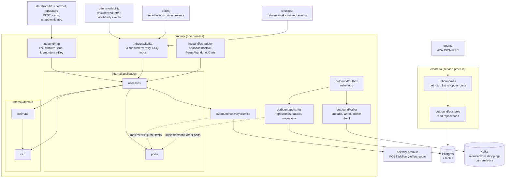

# Architecture

`shopping-cart` follows the fleet's hexagonal (ports and adapters) layout:
dependencies point inward, the domain imports nothing from the rest of the
module, and only `cmd/` wires the layers together. Everything on this page is on
`develop`.

## Layout

| Layer | Path | Role |
| --- | --- | --- |
| Domain | `internal/domain/cart` | The `Cart` aggregate: lines, destination, `DeliveryQuote` (`QuoteGroup`, `QuotedOffer`, `TierUnavailable`), `Selection`, `CheckoutReadiness`, the lifecycle (`AbandonInactive`, `CloseOnCheckoutCompleted`, `MergeInto`), `AcceptRequotedOffers`, the domain errors and the four domain events (`CartLineAdded`, `CartDeliveryQuoted`, `CartAbandoned`, `CartCheckedOut`). |
| Domain | `internal/domain/estimate` | The pure `Compute` of the labelled estimate over prices, the delivery charge `Schedule` and the `TaxTable`; reports `Complete` instead of guessing. Imports `cart` for vocabulary only. |
| Domain | `internal/domain/shared` | `Event`, `Header`, `ErrValidation`, `ErrIllegalTransition`, id and UTC helpers. |
| Application | `internal/application/usecases` | One use case per command, policy and consumed event (see [Use cases](/docs/ddd/use-cases)), the `Consumer` (inbox claim plus effect in one unit of work), the `view` that renders a cart with its estimate and readiness. |
| Application | `internal/application/ports` | The OUT ports: `CartRepository`, `ItemRepository`, `ScheduleRepository`, `TaxTableRepository`, `QuoteOffers`, `Inbox`, `EventOutbox`, `UnitOfWork`, `IdempotencyStore`, `Clock`, `IDGenerator`, `CartMetrics`. Interfaces only. |
| Application | `internal/application/{readmodel,views,outbox,idempotency}` | The read-model item, the cart view, the already-encoded outbox `Message`, the stored idempotency `Record` (TTL 24 h). |
| Inbound adapter | `internal/adapters/inbound/http` | chi router for `apis/openapi.yaml`: handlers, RFC 9457 problem mapping (`errors.go`), the `Idempotency-Key` middleware, the NUL guard, `/healthz` and `/readyz`. No auth middleware. |
| Inbound adapter | `internal/adapters/inbound/kafka` | The three consumers (offer-availability, pricing, checkout): CloudEvents decode, dispatch on the full `type`, retry with backoff, dead-letter topic, a consumer span per attempt. Decode only; every effect is a use case. |
| Inbound adapter | `internal/adapters/inbound/scheduler` | Timer-driven jobs that call the `AbandonInactive` and `PurgeAbandonedCarts` use cases in batches of 200. |
| Inbound adapter | `internal/adapters/inbound/a2a` | The A2A skills `get_cart` and `list_shopper_carts`, the Agent Card, strict skill-request parsing. Read-only; depends on application and domain only. |
| Inbound adapter | `internal/adapters/inbound/requestlog` | The access-log middleware (method, route pattern, status, duration, request id). |
| Outbound adapter | `internal/adapters/outbound/postgres` | pgxpool repositories (`carts`, read models, inbox, idempotency, outbox), the unit of work (`pgtx`), embedded migrations (`migrate.go`), trace-header injection into outbox rows. |
| Outbound adapter | `internal/adapters/outbound/kafka` | The CloudEvents `Encoder` for the four published events, `NewWriter` (acks from all replicas, hash balancer, no fixed topic), the relay `Sink`, `BrokerCheck` (the Kafka half of `/readyz`). |
| Outbound adapter | `internal/adapters/outbound/outbox` | The relay loop that drains `outbox_events` to the sink. |
| Outbound adapter | `internal/adapters/outbound/deliverypromise` | The HTTP client of `POST /delivery-offers:quote` and the time-zone resolution of offer windows (ADR 0007). |
| Outbound adapter | `internal/adapters/outbound/{telemetry,clock,ids}` | OpenTelemetry setup and the `cart.lines.added` counter; the system clock; the cart id generator. |
| Outbound adapter | `internal/adapters/outbound/memory` | In-memory implementation of every port: a **test double** for the unit and godog suites. The shipped binaries never import it (`TestRuntimeBinaryHasNoInMemoryAdapters`). |
| Kafka envelope | `internal/adapters/kafka/cloudevents` | The only place a CloudEvents 1.0 envelope is built or decoded: `New(Spec)`, `Decode`, `Type`, `DataSchema`. `Repo`/`Context` = `shopping-cart`, `Source` = `/retailnetwork/shopping-cart`. |
| Support | `internal/bootretry` | Exponential-backoff retry for the first outbound dials at boot (migrations, Postgres ping). |
| Composition roots | `cmd/api`, `cmd/a2a` | `main.go`, `config.go`, `telemetry.go`, `tzdata.go` (embeds the zone database) and, for a2a, `router.go`. |
| Test support | `internal/testing/{kafkatest,pgtest}`, `internal/adapters/outbound/repocontract` | Testcontainers helpers and the repository contract suite run against both the memory and Postgres adapters. |
| Fitness tests | `internal/architecture` | arch-go and source-scanning tests, see [Testing](/docs/development/testing). |

## Binaries and ports

| Binary | Role | Port | Probes |
| --- | --- | --- | --- |
| `cmd/api` | REST API, the outbox relay, the offer-availability, pricing and checkout consumers and the `AbandonInactive` and `PurgeAbandonedCarts` sweeps, all always on, in one process, on real Postgres and Kafka. | `HTTP_ADDR`, default `:8080` | `GET /healthz` (liveness), `GET /readyz` (drain gate, Postgres ping, a Kafka broker answers a metadata request) |
| `cmd/a2a` | Read-only Agent2Agent agent ([ADR 0006](/docs/adr/0006-a2a-inbound-adapter)): JSON-RPC 2.0 at `/` and `/a2a`, Agent Card at `/.well-known/agent-card.json`. Same Postgres and the same `GetCart` and `ListCarts` use cases as the REST reads; no Kafka, outbox, consumer, sweeper or delivery-promise client. | `A2A_ADDR`, default `:8093` | `GET /healthz` |

There is no `cmd/mcp`. Both binaries run the same embedded migration at boot
(idempotent), so either may start first. Startup order, shutdown order and the
probes are in the [Runbook](/docs/operations/runbook); every variable is in
[Configuration](/docs/operations/configuration).

## Container diagram

Source: `cmd/api/main.go` (`buildAdapters`, `startConsumers`, `startOutboxRelay`,
`startSchedulers`), `cmd/a2a/main.go` (`buildDeps`) and `cmd/a2a/router.go`,
`internal/application/ports/ports.go`, the import lists of
`internal/domain/*/*.go` (`estimate` imports `cart`) and
`internal/architecture/architecture_test.go`. The in-memory adapters are not in
the diagram because no binary wires them.

## Data stores

One Postgres database, created by the single embedded migration
(`internal/adapters/outbound/postgres/migrations/0001_shopping_cart_schema.up.sql`):

| Table | Holds |
| --- | --- |
| `carts` | The Cart aggregate: `state`, `destination`, `lines`, `quote` and `selections` as `jsonb`, `created_at`, `last_changed_at`, `version` (the optimistic-concurrency token). |
| `rm_items` | `PurchasabilityView`: per catalogue item `catalogued`, `discontinued`, `priced`, `price_minor`, `currency`, `price_version`. A row may be a stub when a price event arrives before `CatalogItemCreated`. |
| `rm_current_schedule`, `rm_current_tax_table` | `EstimateView`: the one current delivery charge schedule and tax table (singleton rows, each with its `version`). |
| `processed_events` | The inbox: CloudEvents `id` claims that make the consumers idempotent. |
| `idempotency_keys` | Stored first answers per `(route, key)`; a record older than 24 h is treated as absent and overwritten. |
| `outbox_events` | The transactional outbox, one row per message with its topic, key, encoded CloudEvent, headers (including `traceparent`), `attempts` and `last_error`. |

Postgres is the only store: both binaries refuse to boot without `DATABASE_URL`
and nothing is served from process memory. The schema holds no PII and no card
data. Kafka is the fleet's single broker; this service produces to
`retailnetwork.shopping-cart.analytics` and consumes
`retailnetwork.offer-availability.events`, `retailnetwork.pricing.events` and
`retailnetwork.checkout.events`. It never creates a topic through an admin API:
the broker auto-creates each on first write (including `<topic>.dlq`), and
`/readyz` does not wait for any topic.

## Rules enforced by `internal/architecture`

The tests run on every PR (`arch-test` job, `make arch-test`); the full list is
on [Testing](/docs/development/testing#architecture-fitness-tests). The ones that
shape this layout:

| Test | Rule |
| --- | --- |
| `TestHexagonalArchitecture` (6 subtests) | domain depends only on domain; application only on domain and application; inbound and outbound adapters never depend on each other; nothing under `internal/` imports `cmd`; `internal/application/ports` holds only interfaces. |
| `TestRuntimeBinaryHasNoInMemoryAdapters` | no non-test file under `cmd/**` imports the in-memory adapter: the binaries run on Postgres and Kafka only. |
| `TestA2AAdapterDependencyRule`, `TestA2ASurfaceIsReadOnly` | the A2A adapter depends only on application and domain and reaches only read use cases. |
| `TestNoAuthMiddlewareReintroduced` | REST carries no bearer or JWT handling: unauthenticated fleet-wide. |
| `TestKafkaConsumerGroupNeverHardcodedInline` | consumer group ids come from the three `*_CONSUMER_GROUP` variables. |
| `TestCloudEventsOnly`, `TestEventCatalogueMatchesContract` | CloudEvents 1.0 is the only envelope; every type in `apis/asyncapi.yaml` is in ADR 0004. |
| `TestOutboxRelaysPassAttemptCap` | the relay is built with `WithMaxAttempts`, so a poison row cannot block it. |
